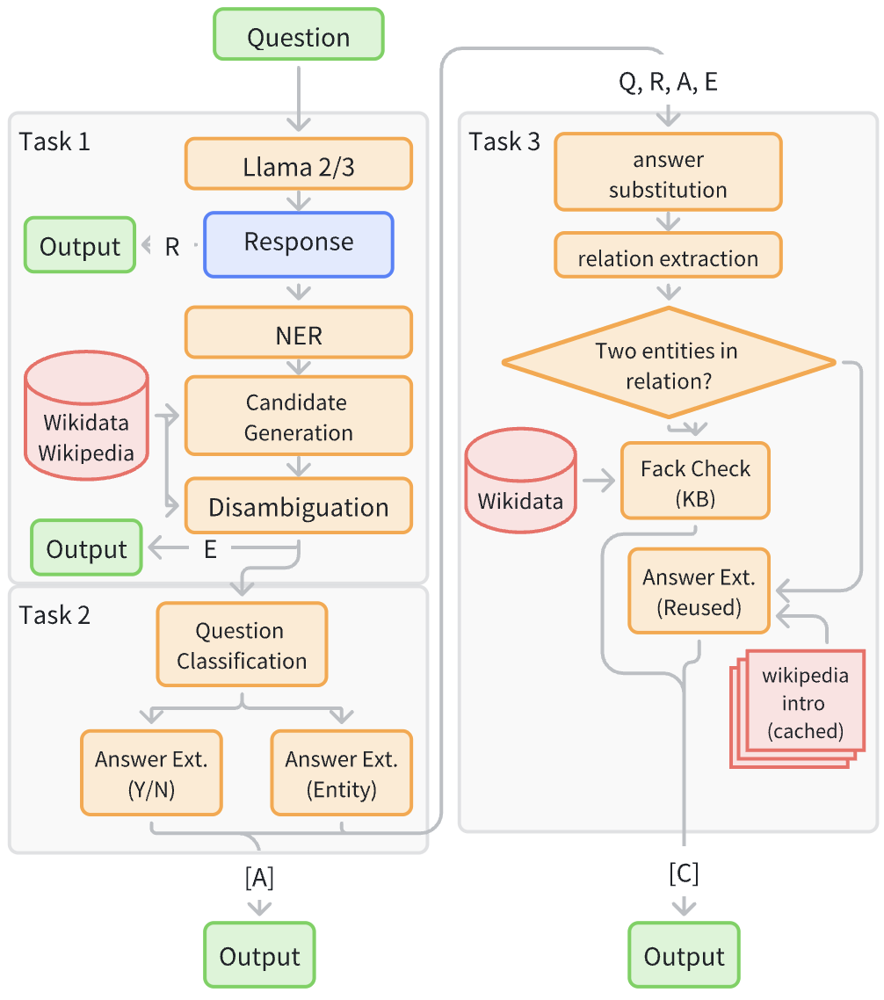
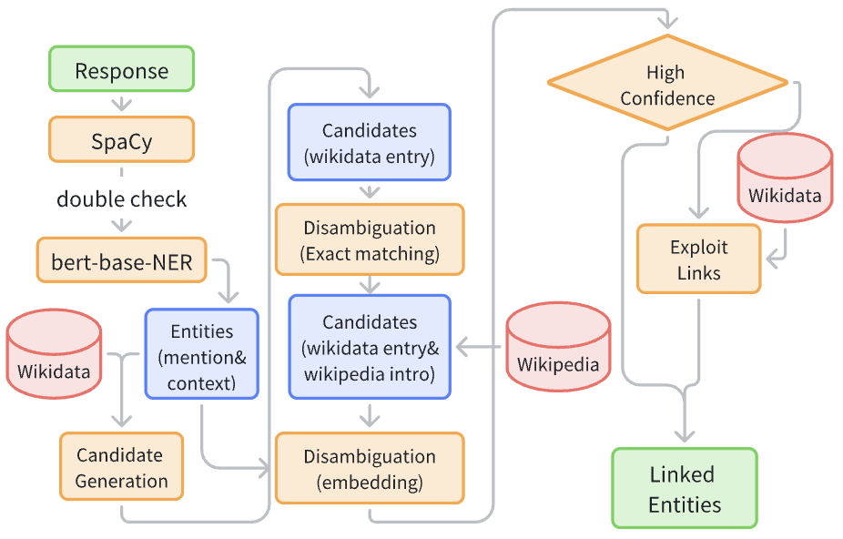
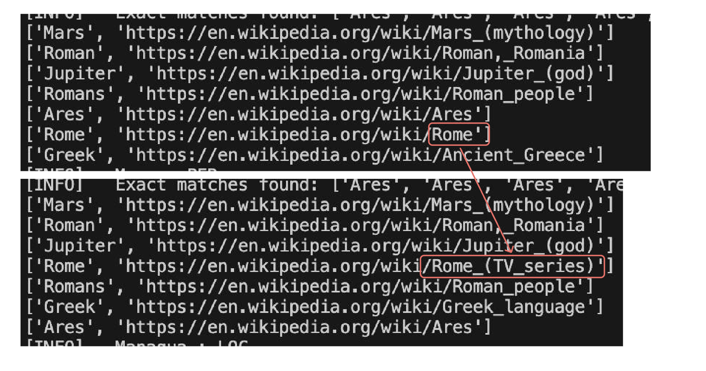

<!-- portfolio:date=2024-10-14 -->
# LLM Fact Auditor

**[English](README.md) · [Deutsch](README.de.md)**

<p align="center"></p>

Eine Python-Datenverarbeitungspipeline zur automatisierten Faktenprüfung (Fact-Checking) und Entity Linking auf LLM-Antworten mithilfe von spaCy, Stanza, CoreNLP, PyTorch und dem Wikidata-Wissensgraphen.

## Highlights

- **Mehrstufiges NLP Entity Linking** — kombiniert `spaCy`, `Stanza`, CoreNLP und `bert-base-NER` (`entity_recognition.py`) mit Wikipedia-/Wikidata-Kandidatensuche sowie kontextbasierter Disambiguierung (`candidate_generation.py`, `disambiguation.py`).
- **Faktenprüfung gegen den Wikidata-Wissensgraphen** — klassifiziert Fragetypen (`question_classification.py`), ersetzt erkannte Entitäten in extrahierten Relationen und prüft Aussagen gegen `Wikidata` sowie zwischengespeicherte Wikipedia-Einleitungen (`fact_check.py`).
- **Lokale Llama-Inferenz im Docker-Container** — kapselt Meta-Llama-Aufrufe in `llama_wrap.py` innerhalb einer reproduzierbaren `Docker`-Umgebung (`Dockerfile`, `requirements.txt`) für Auswertungen an der Vrije Universiteit Amsterdam.

## Screenshots

<p align="center">
  
  
</p>

## Architektur

```
Frage ──► Llama-Inferenz (llama_wrap.py) ──► Rohe LLM-Antwort
                                                  │
   ┌── Task 1: Entity Recognition & Linking ◄─────┘
   │     spaCy · Stanza · CoreNLP · BERT NER ──► Wikidata-Kandidaten & Disambiguierung
   ▼
Task 2: Frageklassifikation (Ja/Nein vs. Entitäts-Extraktion)
   ▼
Task 3: Claim-Extraktion & Fact-Checking (fact_check.py ──► Wikidata-KB + Wikipedia-Cache)
```

## Tech-Stack

Python · PyTorch · LLM · NLP · spaCy · Stanza · CoreNLP · Wikidata · Entity Linking · Fact-Checking · Data Processing · Docker

## Einrichtung

```bash
docker build -t llm-fact-auditor .
pip install -r requirements.txt
python main.py
```
