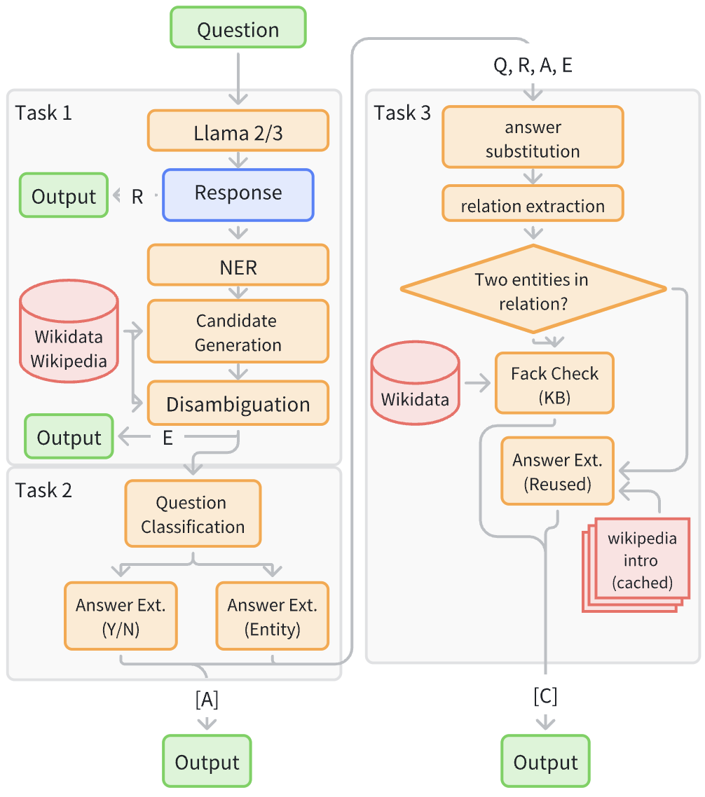
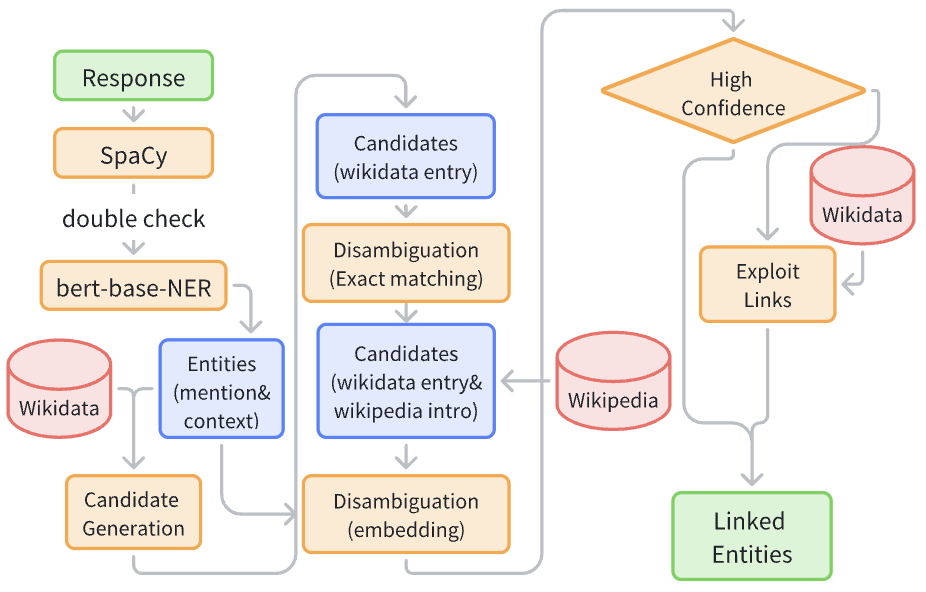
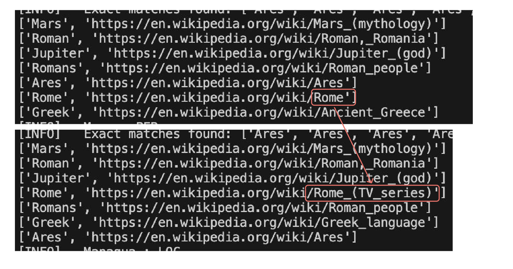

<!-- portfolio:date=2024-10-14 -->
# LLM Fact Auditor

**[English](README.md) · [Deutsch](README.de.md)**

<p align="center"></p>

A Python post-processing data-processing pipeline that runs fact-checking and entity linking over Large Language Model answers using spaCy, Stanza, CoreNLP, PyTorch, and the Wikidata knowledge graph.

## Highlights

- **Multi-stage NLP entity linking** — combines `spaCy`, `Stanza`, CoreNLP, and `bert-base-NER` (`entity_recognition.py`) with Wikipedia/Wikidata candidate generation and embedding-based disambiguation (`candidate_generation.py`, `disambiguation.py`).
- **Wikidata knowledge-graph fact-checking** — classifies questions (`question_classification.py`), substitutes resolved entities into extracted relations, and verifies factual claims against cached Wikipedia intros and `Wikidata` (`fact_check.py`).
- **Local Llama generation & containerized execution** — wraps Meta Llama inference in `llama_wrap.py` inside a reproducible `Docker` setup (`Dockerfile`, `requirements.txt`) for repeatable evaluation at Vrije Universiteit Amsterdam.

## Screenshots

<p align="center">
  
  
</p>

## Architecture

```
Question ──► Llama Inference (llama_wrap.py) ──► Raw LLM Response
                                                       │
   ┌── Task 1: Entity Recognition & Linking ◄──────────┘
   │     spaCy · Stanza · CoreNLP · BERT NER ──► Wikidata Candidate Gen + Disambiguation
   ▼
Task 2: Question Classification (Y/N vs Entity Extraction)
   ▼
Task 3: Claim Extraction & Fact-Checking (fact_check.py ──► Wikidata KB + cached Wikipedia intro)
```

## Tech Stack

Python · PyTorch · LLM · NLP · spaCy · Stanza · CoreNLP · Wikidata · Entity Linking · Fact-Checking · Data Processing · Docker

## Getting Started

```bash
docker build -t llm-fact-auditor .
pip install -r requirements.txt
python main.py
```
